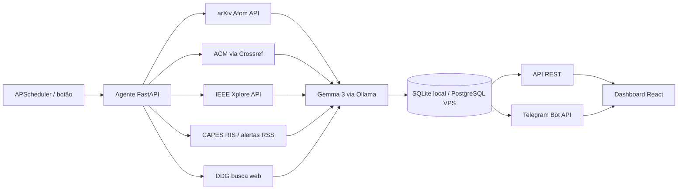

# Academic Pulse AI

Agente de curadoria científica com painel web. Todos os dias, ele consulta **arXiv, ACM, fontes configuradas do Portal CAPES** e resultados da busca web; a **IEEE** entra após configuração e autorização aplicável. Os temas são **Small Language Models (SLM)**, **Retrieval Augmented Generation (RAG)** e **IA na Educação**. O Gemma 3 via Ollama classifica e resume os resultados em português, o backend guarda o relatório e o Telegram envia um aviso com link para o painel. O projeto pode rodar localmente ou inteiro em uma VPS.

> Projeto de portfólio. A nota exibida é **relevância temática estimada pelo modelo** (0–100); não representa citações, qualidade metodológica ou impacto científico. Para resultados web, o texto original disponível pode ser apenas o trecho da busca. Consulte sempre a fonte original.

## Arquitetura



O scheduler roda no mesmo processo do backend. O Compose inicia **um único worker** para evitar execuções duplicadas. Cada dia com artigos elegíveis tem um relatório: nova execução no mesmo dia atualiza seu conteúdo. A notificação é enviada depois da gravação; se o Telegram falhar, o relatório continua disponível.

### Marco temporal e seleção no painel

Antes da primeira rodada, abra **Fontes e temas** no menu do dashboard. Ali você escolhe os portais ativos, os assuntos SLM/RAG/IA na Educação e até oito domínios para a busca web. As escolhas ficam na tabela `agent_preferences` e valem tanto para o botão manual quanto para o agendamento diário. Para usar a busca web, ative **Sites escolhidos** e informe ao menos um domínio.

A rotina agendada aguarda o primeiro salvamento dessas escolhas. A **primeira execução após a configuração grava sua data no fuso `TIMEZONE`** como marco inicial imutável. Ela não cria relatório retroativo. Nas próximas rodadas, um artigo só é analisado se a fonte fornecer data de publicação **posterior** a esse dia e não posterior à data atual; itens sem data verificável são descartados. Datas informadas apenas como mês ou ano são interpretadas pelo primeiro dia possível, de forma conservadora. O painel mostra o marco inicial e a data de cada artigo. Relatórios já existentes antes desta atualização fazem o marco inicial assumir a data do relatório mais antigo, pois não há registro confiável de execuções anteriores.

## Estrutura

```text
academic-pulse-ai/
├── .env.example
├── .env.vps.example
├── .gitignore
├── docker-compose.yml
├── compose.vps.yml
├── README.md
├── backend/
│   ├── .dockerignore
│   ├── Dockerfile
│   ├── requirements.txt
│   └── app/
│       ├── __init__.py
│       ├── config.py
│       ├── db.py
│       ├── main.py              # API FastAPI
│       ├── models.py            # DailyReport e Paper
│       │                        # AgentPreferences
│       ├── schemas.py           # contratos e JSON do LLM
│       └── agent/
│           ├── __init__.py
│           ├── agent.py         # orquestração
│           ├── database.py      # persistência transacional
│           ├── fetcher.py       # arXiv e DDG
│           │                    # ACM, IEEE e CAPES
│           ├── preferences.py   # marco inicial e seleção persistida
│           ├── publication.py   # datas de publicação
│           ├── llm.py           # Gemma 3, JSON estruturado
│           ├── notifier.py      # Telegram
│           ├── telegram.py      # chamada à Bot API
│           └── scheduler.py     # rotina diária
├── frontend/
│   ├── .dockerignore
│   ├── Dockerfile
│   ├── Dockerfile.prod
│   ├── Caddyfile
│   ├── index.html
│   ├── package.json
│   ├── tsconfig.json
│   ├── vite.config.ts
│   └── src/
│       ├── api.ts
│       ├── App.tsx
│       ├── main.tsx
│       ├── styles.css
│       └── types.ts
├── data/                    # criado localmente, ignorado pelo Git
└── imports/capes/           # exportações RIS, ignoradas pelo Git
```

## Pré-requisitos

- Docker Engine com Compose v2 (ou Python 3.12+ e Node.js 22+ para execução sem Docker).
- [Ollama](https://ollama.com/download) instalado no computador que executa o projeto.
- Acesso à internet para as APIs arXiv, Crossref, IEEE (se habilitada), busca web e Telegram.
- Para notificações: bot criado com [@BotFather](https://t.me/BotFather), token e ID do chat. Abra uma conversa com o bot e envie `/start` antes da primeira notificação.

## Instalação com Docker

1. Baixe o modelo no computador: `ollama pull gemma3:4b`.
2. Confirme que o Ollama está rodando: `ollama serve` (se já estiver ativo, não inicie outro processo).
3. Copie o ambiente: `cp .env.example .env`.
4. Edite `.env`: horário, fuso, URL do painel e, se desejar, credenciais IEEE/Telegram e feeds CAPES. Defina `TRIGGER_API_KEY` caso a API seja acessível fora do seu computador.
5. Inicie: `docker compose up --build -d`.
6. Abra `http://localhost:5173`. A documentação da API fica em `http://localhost:8000/docs`.
7. Abra **Fontes e temas**, salve sua seleção e clique em **Executar agente agora**. Essa primeira rodada fixa a data inicial; relatórios começam quando houver artigos publicados depois dela.

No Linux, o container acessa o Ollama no host por `host.docker.internal:11434`. Se houver erro de conexão, configure o Ollama para escutar numa interface acessível ao Docker (por exemplo, `OLLAMA_HOST=0.0.0.0:11434` no serviço Ollama) e reinicie-o. Restrinja o acesso a essa porta à sua rede de confiança.

O painel e a API são publicados apenas em `127.0.0.1` por padrão. Para abrir o relatório no celular pelo botão do Telegram, use uma URL que o celular consiga acessar (IP da rede local com portas publicadas na LAN, VPN ou túnel HTTPS) em `DASHBOARD_URL`. `localhost` no celular aponta para o próprio celular. Ajuste também `VITE_API_URL` e as portas do Compose se for servir o painel pela rede.

## Implantação em VPS

O arquivo `compose.vps.yml` sobe **PostgreSQL, Ollama, backend e Caddy** na mesma VPS. O frontend é compilado como arquivos estáticos; Caddy publica o painel e encaminha `/api/*` ao FastAPI, com HTTPS automático e autenticação básica. PostgreSQL e Ollama não expõem portas públicas. Use **um único container backend** porque o APScheduler é interno ao processo.

1. Aponte um domínio para o IP público da VPS e libere as portas **80 e 443** no firewall. Instale Docker Engine e Compose v2.
2. Copie `cp .env.vps.example .env.vps` e preencha `APP_DOMAIN`, `DASHBOARD_URL=https://SEU_DOMINIO`, `POSTGRES_PASSWORD` (recomenda-se `openssl rand -hex 32`), `TRIGGER_API_KEY` e as credenciais opcionais.
3. Gere o hash da senha de acesso com `docker run --rm -it caddy:2-alpine caddy hash-password`. Cole o resultado entre **aspas simples** em `DASHBOARD_PASSWORD_HASH` no `.env.vps`. O usuário do painel é `pulse`.
4. Crie a pasta `mkdir -p imports/capes` e inicie: `docker compose --env-file .env.vps -f compose.vps.yml up --build -d`.
5. Baixe o modelo dentro do serviço: `docker compose --env-file .env.vps -f compose.vps.yml exec ollama ollama pull gemma3:4b`.
6. Acesse `https://SEU_DOMINIO`, autentique-se, configure **Fontes e temas** e execute o agente pelo botão para registrar a data inicial. Para acompanhar: `docker compose --env-file .env.vps -f compose.vps.yml logs -f backend`.

O modelo `gemma3:4b` ocupa cerca de 3,4 GB só em disco; dimensione RAM e CPU da VPS com folga para a inferência, ou use `gemma3:1b` em uma máquina menor (ajuste `OLLAMA_MODEL` e faça o pull da mesma tag). [Tamanhos publicados pelo Ollama](https://ollama.com/library/gemma3). O volume `postgres_data` guarda relatórios e `ollama_data` guarda o modelo. Faça backup regular do volume PostgreSQL. Para atualizar: `docker compose --env-file .env.vps -f compose.vps.yml up --build -d`.

### Fontes adicionais

| Fonte | Como entra no agente | O que configurar |
| --- | --- | --- |
| **ACM** | Trabalhos com DOI prefixado por `10.1145` obtidos pela API Crossref; o link aponta para o DOI original. | Nada. Para síntese, só entram registros com resumo e licença Creative Commons indicada nos metadados. |
| **IEEE Xplore** | Adaptador da API oficial de busca de metadados e resumos. | Solicite uma chave no [portal IEEE](https://developer.ieee.org/getting_started). A síntese exige também autorização específica para o uso pretendido antes de definir `IEEE_AI_PERMISSION_GRANTED=true`. |
| **Portal CAPES** | Exportações RIS em `imports/capes/` ou feeds RSS/Atom de alertas de bases acessadas pelo Portal. | Ative CAPES no painel, exporte resultados RIS para a pasta; opcionalmente informe URLs HTTPS separadas por vírgula em `CAPES_RSS_URLS`. Registros precisam de data de publicação. |
| **Sites web** | Busca DDG limitada aos domínios salvos no painel; o agente lê metadados da página para encontrar a data do artigo. | Ative **Sites escolhidos** e informe os domínios em **Fontes e temas**. Páginas sem `datePublished` ou metadado equivalente são descartadas. |

O Portal CAPES dá acesso a coleções com licenças e autenticação institucional. A [documentação do Portal](https://www.periodicos.capes.gov.br/images/documents/Guia%20r%C3%A1pido%20do%20Portal%20de%20Peri%C3%B3dicos_2025.pdf) descreve exportação RIS/BibTeX, e o [acesso remoto CAFe](https://www2.periodicos.capes.gov.br/index.php/informativos/86-perguntas-frequentes/acesso-remoto-e-comunidade-acad%C3%AAmica-federada-cafe/3848-como-acessar-o-conteudo-do-portal-de-periodicos-da-cafe.html) exige identificação institucional. O agente **não automatiza login CAFe nem coleta texto integral licenciado**. A importação RIS é uma ponte para os metadados que o usuário exportou legitimamente; feeds dependem da disponibilidade e das permissões da base assinada. Arquivos CAPES sem resumo são ignorados. Registros IEEE/ACM exportados do Portal são ignorados por esse caminho e seguem suas próprias regras de licença.

Os [termos atuais da IEEE](https://developer.ieee.org/API_Terms_of_Use2) restringem o uso do conteúdo da API com IA; uma chave de API, por si só, não comprova autorização para sintetizar conteúdo e armazenar a saída. O adaptador IEEE permanece desativado até que você obtenha autorização aplicável ao projeto. O [Crossref também distingue o direito autoral dos resumos](https://www.crossref.org/documentation/retrieve-metadata/), por isso o conector ACM filtra por licença aberta declarada.

## Execução sem Docker

```bash
cp .env.example .env
cd backend
python -m venv .venv
source .venv/bin/activate
pip install -r requirements.txt
```

Defina `DATABASE_URL=sqlite:///./data/academic_pulse.db` e `OLLAMA_HOST=http://localhost:11434` no ambiente do terminal. Carregue as demais variáveis do `.env` (por exemplo, `set -a; source ../.env; set +a`, depois sobrescreva essas duas). Inicie `uvicorn app.main:app --reload --port 8000`.

Em outro terminal:

```bash
cd frontend
npm install
npm run dev
```

## Configuração

| Variável | Função | Padrão do exemplo |
| --- | --- | --- |
| `OLLAMA_MODEL` | Modelo local | `gemma3:4b` |
| `OLLAMA_HOST` | Endereço da API Ollama visto pelo backend | `http://host.docker.internal:11434` |
| `DATABASE_URL` | Conexão SQLAlchemy | SQLite em `./data` no container |
| `SCHEDULE_HOUR`, `SCHEDULE_MINUTE` | Horário diário | `08:00` |
| `TIMEZONE` | Fuso do agendamento e da data do relatório | `America/Maceio` |
| `MAX_PAPERS_PER_RUN` | Limite de textos analisados em cada execução | `9` |
| `IEEE_API_KEY` | Chave da API IEEE Xplore; exige também autorização indicada abaixo | vazio |
| `IEEE_AI_PERMISSION_GRANTED` | Confirma autorização específica para usar a saída IEEE no pipeline de IA | `false` |
| `CAPES_IMPORT_DIR`, `CAPES_RSS_URLS` | Exportações RIS e feeds de alertas CAPES | pasta local, feeds vazios |
| `DASHBOARD_URL` | Link do botão no Telegram e origem CORS | `http://localhost:5173` |
| `TELEGRAM_BOT_TOKEN`, `TELEGRAM_CHAT_ID` | Ativam a notificação | vazios |
| `TRIGGER_API_KEY` | Protege o endpoint de disparo manual | vazio no modo local |

Para obter o `TELEGRAM_CHAT_ID`, após enviar `/start` ao bot, acesse `https://api.telegram.org/bot<SEU_TOKEN>/getUpdates` no navegador e procure `message.chat.id`. Não publique o token nem o arquivo `.env`.

## API

| Método | Rota | Descrição |
| --- | --- | --- |
| `GET` | `/api/reports?page=1&page_size=10&tag=RAG&q=busca&from_date=2026-01-01&to_date=2026-12-31` | Lista paginada, filtros combináveis |
| `GET` | `/api/reports/{id}` | Relatório completo e artigos |
| `GET` | `/api/agent/status` | Estado e última falha do agente |
| `GET` | `/api/settings` | Fontes, temas, domínios e data da primeira rodada |
| `PUT` | `/api/settings` | Salva a seleção; `X-API-Key` se configurado |
| `POST` | `/api/trigger-agent` | Inicia a coleta (HTTP 202); `X-API-Key` se configurado |
| `GET` | `/api/health` | Saúde básica da API |

O disparo manual devolve 202 imediatamente. O painel consulta `/api/agent/status` a cada cinco segundos. Execuções simultâneas recebem 409. O botão solicita a chave apenas se o backend responder 401 e guarda a chave na sessão do navegador.

Exemplo de corpo para `PUT /api/settings`:

```json
{"enabled_sources":["arxiv","acm","capes","web"],"enabled_topics":["SLM","RAG","EdTech"],"web_domains":["nature.com","edutopia.org"]}
```

## Decisões de projeto

- **Rastreabilidade:** título, autores, texto recebido, origem, link, data de publicação e síntese são guardados por artigo.
- **Respostas previsíveis:** o Ollama recebe um JSON Schema do Pydantic e as respostas são validadas antes da persistência.
- **Falhas parciais:** uma fonte indisponível não interrompe as outras; o pipeline falha se nenhuma fonte ou análise produzir conteúdo.
- **Uso responsável do arXiv:** requisições sequenciais respeitam intervalo mínimo de três segundos, conforme os [termos da API](https://info.arxiv.org/help/api/tou.html).
- **SQLite local, PostgreSQL na VPS:** o Compose de produção fornece a conexão PostgreSQL ao SQLAlchemy e mantém os dados em volume persistente.
- **Segurança local:** o Compose vincula as portas ao loopback. Ao publicar na internet, use autenticação, HTTPS, proteção da API e hospedagem apropriada para a interface.

## Referências das integrações

[Gemma 3 no Ollama](https://ollama.com/library/gemma3) · [Busca estruturada do Ollama](https://docs.ollama.com/capabilities/structured-outputs) · [DDGS](https://pypi.org/project/ddgs/) · [arXiv API](https://info.arxiv.org/help/api/user-manual.html) · [Crossref REST API](https://www.crossref.org/documentation/retrieve-metadata/rest-api/) · [IEEE Xplore API](https://developer.ieee.org/docs) · [Telegram Bot API](https://core.telegram.org/bots/api) · [APScheduler 3.x](https://apscheduler.readthedocs.io/en/3.x/userguide.html) · [Caddy](https://caddyserver.com/docs/)

